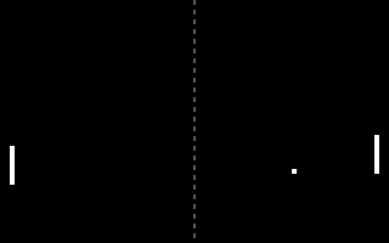
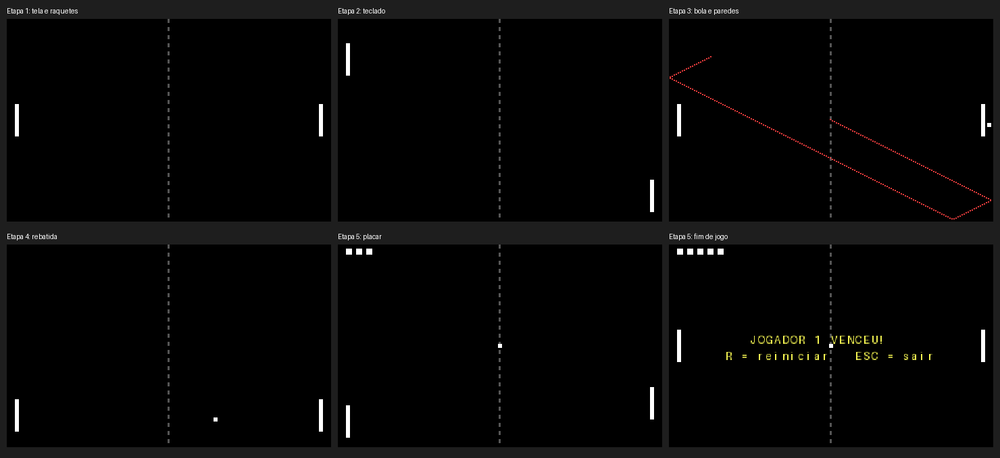

# Pong em Assembly

Jogo Pong escrito em Assembly x86 (16 bits, modo real), desenvolvido para a disciplina de **Arquitetura de Computadores** do curso de Bacharelado Interdisciplinar em Ciência e Tecnologia da **UFMA**. O jogo roda no DOSBox, em qualquer computador.

<p align="center">
  
</p>
<p align="center"><sub>Partida com dois jogadores automáticos, gerada pela simulação do código.</sub></p>

## Como jogar

1. Instale o **DOSBox**: <https://www.dosbox.com>
2. Baixe esta pasta (**Code → Download ZIP**) e extraia.
3. Abra o jogo:
   - **Windows:** dê dois cliques em `JOGAR.bat`
   - **Linux / macOS:** no terminal, execute `./jogar.sh`

Não precisa instalar mais nada: os executáveis já estão na pasta `executaveis`.

### Controles

| Tecla | Função |
|---|---|
| `W` / `S` | Raquete do jogador 1 (esquerda) |
| `↑` / `↓` | Raquete do jogador 2 (direita) |
| `R` | Reiniciar a partida (depois do fim de jogo) |
| `ESC` | Sair |

Vence quem fizer **5 pontos**. O placar aparece como quadradinhos no topo da tela.

### Jogar uma etapa do desenvolvimento

O jogo foi construído em etapas. Para ver cada uma, passe o número (de 1 a 5):

```
JOGAR.bat 3
./jogar.sh 3
```

| Etapa | O que faz |
|---|---|
| 1 | Tela com a área de jogo e as duas raquetes (espera uma tecla para sair) |
| 2 | Raquetes controladas pelo teclado, para dois jogadores |
| 3 | Bola em movimento, com rebote nas paredes |
| 4 | Rebatida nas raquetes, com ângulo conforme o ponto de impacto |
| 5 | Placar, vitória e reinício |
| 6 | Jogo completo (`PONG.COM`, é o que abre por padrão) |



### Abrir manualmente no DOSBox

Se o `JOGAR.bat` não encontrar o DOSBox, abra o DOSBox e digite (troque o caminho pelo da sua pasta):

```
mount c "C:\caminho\para\pong-assembly\executaveis"
c:
pong
```

## Estrutura da pasta

```
pong-assembly/
├── JOGAR.bat / jogar.sh      abre o jogo no DOSBox
├── montar.bat / montar.sh    gera os executáveis (precisa do NASM)
├── dosbox.conf               configuração do DOSBox
├── src/pong.asm              código-fonte (todas as etapas em um arquivo)
├── executaveis/              PONG.COM e ETAPA1.COM a ETAPA5.COM
└── imagens/                  prints e GIF do jogo
```

## Como o jogo funciona

A cada quadro (cerca de 70 por segundo), o programa repete três tarefas: ler as teclas, atualizar o jogo (mover raquetes e bola, tratar colisões e placar) e desenhar a tela.

- **Vídeo:** modo gráfico VGA 13h, 320×200 pixels. A tela é a região de memória que começa em `A000h`. O quadro é montado primeiro numa área da RAM (back buffer) e depois copiado de uma só vez para a tela.
- **Teclado:** rotina de interrupção (INT 9) que lê a porta `60h` e guarda o estado de cada tecla, o que permite dois jogadores ao mesmo tempo.
- **Tempo:** o jogo espera o retraço vertical da tela (porta `3DAh`), então a velocidade não depende do processador.
- **Bola:** posição e velocidade ficam em variáveis com sinal. Na colisão, a velocidade troca de sinal, e na raquete o ângulo de saída depende do ponto de impacto.

### Conceitos de Arquitetura de Computadores no código

| Conceito | Onde aparece |
|---|---|
| Registradores | Parâmetros e cálculos das rotinas (`AX`, `BX`, `CX`, `DX`, `SI`, `DI`) |
| Memória e segmentação | Endereço físico = segmento × 16 + deslocamento |
| Memória mapeada | Escrever em `A000h` altera os pixels da tela |
| Portas de E/S | `in` e `out` nas portas `60h`, `20h`, `3DAh` e `40h` |
| Interrupções | Rotina do INT 9, EOI e `iret` |
| Polling | Espera do retraço vertical |
| Controle de fluxo | `cmp` e saltos condicionais |
| Complemento de dois | Velocidades negativas, `neg` e `sar` |
| Pilha | `call`/`ret`, `push`/`pop` |
| Instruções de bloco | `rep stosb` e `rep movsw` |


## Problemas comuns

| Problema | O que fazer |
|---|---|
| `JOGAR.bat` diz que não encontrou o DOSBox | Instale o DOSBox em <https://www.dosbox.com> e execute de novo |
| `Illegal command` no DOSBox | O `mount` apontou para a pasta errada. Use a pasta `executaveis` |
| Teclas não respondem | Clique dentro da janela do DOSBox |
| Jogo lento | Aumente a velocidade do DOSBox com `Ctrl+F12` |
| Pasta dentro do OneDrive não abre | Clique com o botão direito na pasta e escolha **Sempre manter neste dispositivo**, ou copie para `C:\pong` |